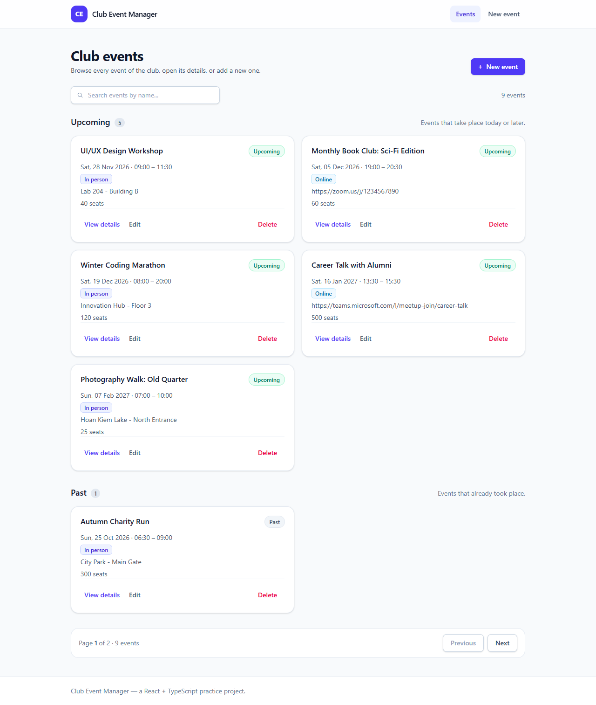
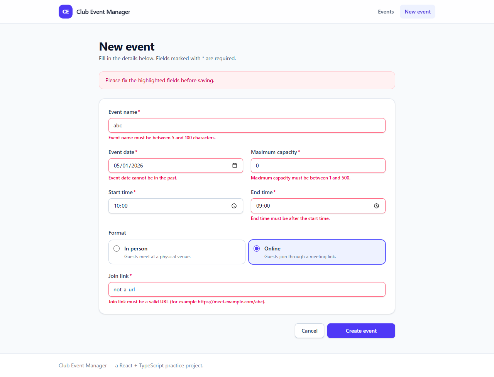
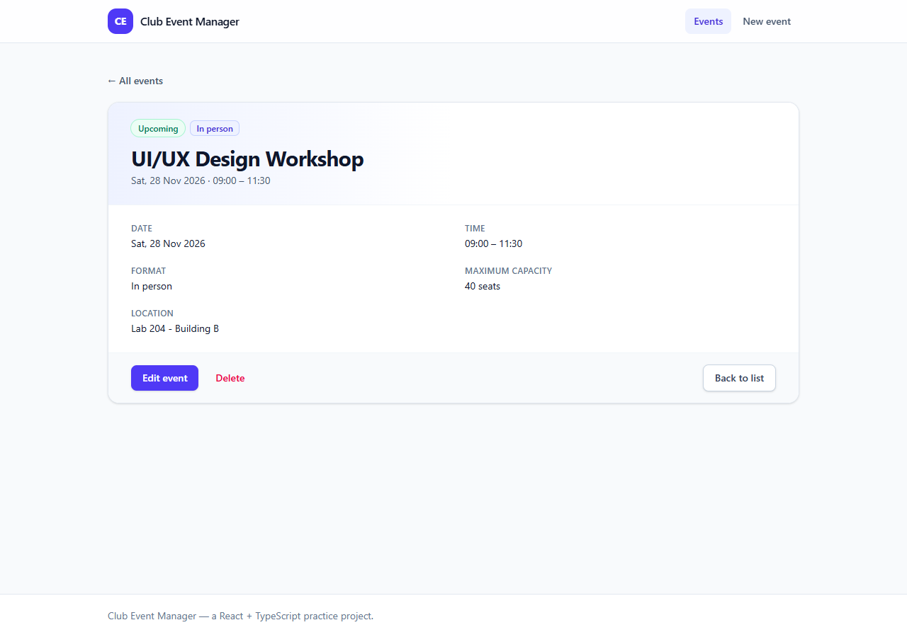
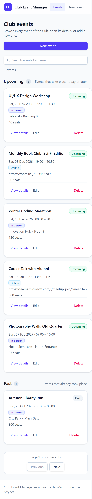
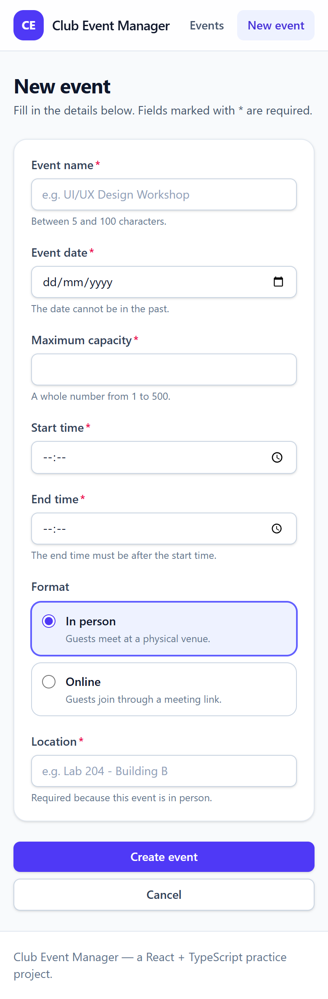

# Club Event Manager

A small CRUD web app for managing club events, built with **Vite + React + TypeScript + Tailwind CSS + React Router**. The data is stored in a local `json-server` API (`server/db.json`).

You can browse all events (split into **Upcoming** and **Past**), open an event, create a new one, edit it, and delete it after a confirmation step. The list supports API pagination and API search.



## Tech stack

| Area | Choice |
| --- | --- |
| Build tool | Vite 8 |
| UI library | React 19 |
| Language | TypeScript (strict, no `any`) |
| Styling | Tailwind CSS v4 (`@tailwindcss/vite`) |
| Routing | React Router 7 |
| HTTP client | axios (one shared instance with `baseURL`) |
| Mock API | json-server (data in `server/db.json`) |
| Forms | Hand-written with `useState` (no form library, no schema library) |

## Getting started

Requirements: Node.js 20.19+ (or 22.12+) and npm.

```bash
# 1. install dependencies
npm install

# 2. start the mock API on http://localhost:4000 (terminal 1)
npm run api

# 3. start the dev server on http://localhost:5173 (terminal 2)
npm run dev
```

Open <http://localhost:5173> in the browser.

Optional: `npm start` runs both commands at the same time with `concurrently`.

### Available scripts

| Script | What it does |
| --- | --- |
| `npm run dev` | Starts the Vite dev server (port 5173) |
| `npm run api` | Starts json-server with `server/db.json` (port 4000) |
| `npm run build` | Type-checks with `tsc -b` and builds for production |
| `npm run preview` | Serves the production build locally |
| `npm run lint` | Runs ESLint |
| `npm start` | Runs `npm run api` and `npm run dev` together |

### API base URL

The axios instance reads `VITE_API_BASE_URL` and falls back to `http://localhost:4000`:

```ts
// src/services/api.ts
export const api = axios.create({
  baseURL: import.meta.env.VITE_API_BASE_URL ?? 'http://localhost:4000',
});
```

If you need another port, copy `.env.example` to `.env` and change the value.

## Screenshots

**List page** – events are grouped into "Upcoming" and "Past", with search and pagination:


**Form with validation errors** – errors appear under the fields, after blur and on submit:



**Detail page** – full information of one event:



**Mobile view** – list page and form on a 390 px wide screen:

| List | Form |
| --- | --- |
|  |  |

## Features

### Pages and navigation

- Shared layout for every page: header (app name + menu) and footer.
- `/events` – list of all events.
- `/events/:id` – event detail.
- `/events/new` – create form.
- `/events/:id/edit` – edit form, pre-filled with data from the API.
- 404 page for unknown URLs, and a "not found" message for a detail/edit URL with an unknown id.
- The menu item of the current page is highlighted (`aria-current="page"`).
- `/` redirects to `/events`.

### Form and validation

- One shared `EventForm` component is used by the create page and the edit page.
- Reusable `TextField` (text, date, time, number, URL) and `RadioGroup` components.
- Labels for every field, a `*` marker for required fields.
- Errors are shown when the user leaves a field (blur) and when the form is submitted; invalid inputs get a red border and a message directly below.
- The submit button is disabled and shows "Saving..." while the request is running, so the form cannot be sent twice.

| Field | Input | Rule |
| --- | --- | --- |
| Event name | text | required, 5–100 characters |
| Event date | date | required; when **creating**, it cannot be in the past |
| Start time | time | required |
| End time | time | required, must be **after** the start time |
| Format | radio | In person / Online |
| Location | text | required when the format is **In person** |
| Join link | url | required and a valid `http(s)` URL when the format is **Online** |
| Maximum capacity | number | whole number from 1 to 500 |

All rules live in one function, `src/utils/validateEvent.ts`, which returns an object with one message per invalid field and is shared by both pages. Only the "not in the past" rule depends on the mode (`create` vs `edit`), so old events can still be edited.

### API usage

All requests go through `src/services/eventsService.ts`; components never import axios.

| Action | Request |
| --- | --- |
| List (paged, searchable) | `GET /events?_page=1&_per_page=6&_sort=-date,-startTime&name:contains=...` |
| Detail | `GET /events/:id` |
| Create | `POST /events` |
| Update | `PUT /events/:id` |
| Delete | `DELETE /events/:id` |

Changes are written to `server/db.json`, so they are still there after a page reload and after restarting the API.

### UI states

- Loading state while waiting for the API (list, detail, edit page).
- Clear error message when the API is not running, with a "Try again" button.
- Empty state when there are no events and a different one when a search returns nothing.
- Success toast after creating, updating, and deleting an event.
- Fully responsive layout (mobile-first Tailwind classes).

### Extra features

- **Pagination through the API** (`_page`, `_per_page`), with Previous/Next buttons and a page counter.
- **Search through the API** (`name:contains=...`) instead of filtering in the browser, debounced by 350 ms.
- **Custom delete confirmation** (`ConfirmDialog`) and **custom toasts** (`ToastProvider`) — no `window.confirm()` or `alert()` anywhere.

## Project structure

```text
reactbig/
├─ server/
│  └─ db.json                 # 9 sample events (json-server database)
├─ public/
│  └─ favicon.svg
├─ docs/
│  └─ screenshots/            # images used in this README
├─ src/
│  ├─ components/
│  │  ├─ Button.tsx
│  │  ├─ ConfirmDialog.tsx
│  │  ├─ DeleteEventButton.tsx
│  │  ├─ EmptyState.tsx
│  │  ├─ ErrorState.tsx
│  │  ├─ EventBadges.tsx
│  │  ├─ EventCard.tsx
│  │  ├─ EventForm.tsx
│  │  ├─ LoadingState.tsx
│  │  ├─ NotFoundMessage.tsx
│  │  ├─ Pagination.tsx
│  │  ├─ RadioGroup.tsx
│  │  ├─ SearchBar.tsx
│  │  ├─ TextField.tsx
│  │  └─ ToastProvider.tsx
│  ├─ context/
│  │  └─ ToastContext.ts      # toast context + useToast hook
│  ├─ hooks/
│  │  └─ useDebouncedValue.ts
│  ├─ layouts/
│  │  └─ MainLayout.tsx       # header, main outlet, footer
│  ├─ pages/
│  │  ├─ EventCreatePage.tsx
│  │  ├─ EventDetailPage.tsx
│  │  ├─ EventEditPage.tsx
│  │  ├─ EventListPage.tsx
│  │  └─ NotFoundPage.tsx
│  ├─ services/
│  │  ├─ api.ts               # shared axios instance + error helpers
│  │  └─ eventsService.ts     # all event API calls
│  ├─ types/
│  │  ├─ api.ts               # paginated response type
│  │  ├─ event.ts             # ClubEvent, EventInput, formats, status
│  │  ├─ form.ts              # form values, errors, touched, mode
│  │  └─ ui.ts                # toast and radio option types
│  ├─ utils/
│  │  ├─ date.ts              # date helpers and Upcoming/Past status
│  │  ├─ eventForm.ts         # event <-> form values conversion
│  │  └─ validateEvent.ts     # all validation rules
│  ├─ App.tsx                 # routes
│  ├─ index.css               # Tailwind entry point and base styles
│  └─ main.tsx                # React root + BrowserRouter
├─ index.html
├─ package.json
└─ vite.config.ts
```

## Routes

| URL | Page |
| --- | --- |
| `/` | redirects to `/events` |
| `/events` | event list |
| `/events/new` | create event |
| `/events/:id` | event detail |
| `/events/:id/edit` | edit event |
| anything else | 404 page |

## Demo video

The 3–5 minute walkthrough video is uploaded to Google Drive (public view). Paste the link here before submitting:

`https://drive.google.com/...`
